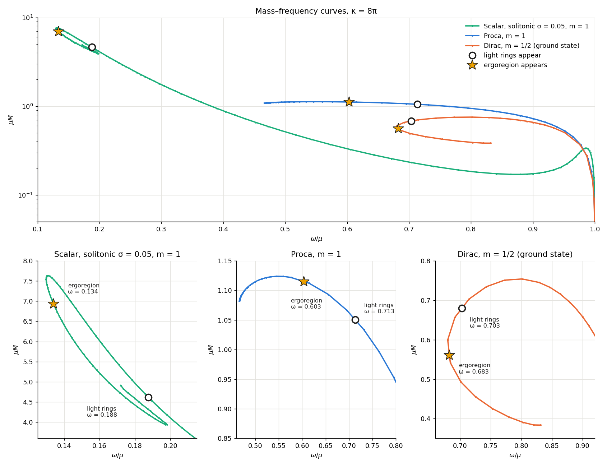

# Rotating_BS_solver

A C++17 relaxation solver for stationary, self-gravitating stars made of massive complex fields:
**boson stars** (scalar field, with a choice of self-interaction potentials), **Proca stars** (vector
field) and **Dirac stars** (spinor field). It builds:

- **spherical** scalar boson stars and flat-space Q-balls (1D, in $r$);
- **rotating**, axisymmetric stars with azimuthal number $m$ (2D, in $r,\theta$);

and follows whole families of solutions through their turning points with pseudo-arclength
continuation. Every model is reported with its mass, Noether charge, angular momentum and
compactness, and optionally its light rings and ergoregion.



*Mass–frequency curves of rotating solitonic boson stars ($\sigma=0.05$, $m=1$), Proca stars
($m=1$) and Dirac stars ($m=\frac12$, ground state), with the points where light rings (circles) and
an ergoregion (stars) first appear. $G=\mu=1$.*

## Contents

- [Features](#features)
- [Building](#building)
- [Quick start](#quick-start)
- [How it works](#how-it-works)
- [Output files](#output-files)
- [Parameter reference](#parameter-reference)
- [Environment variables](#environment-variables)
- [Symbolic derivation tools](#symbolic-derivation-tools)
- [Validation](#validation)
- [Practical tips](#practical-tips)
- [Repository layout](#repository-layout)
- [References](#references)

## Features

- **Field equations generated symbolically.** The 2D equations, their boundary rows and the
  densities for $M$, $Q$, $J$ are generated by sympy scripts (`tools/`) from the metric and the
  matter Lagrangian and checked there, so no long equation was transcribed by hand.
- **Matter models** (`matter`):
  - `scalar` with the potentials `mini`, `repulsive`, `solitonic`, `kkls`, `axionic`, `kleihaus`;
  - `proca`, a free vector field;
  - `dirac`, a single free spinor; implemented for $m=\frac12$.
- **Whole families.** Pseudo-arclength continuation passes the turning points in $\omega$, $Q$ and $M$
  with no mode switching. Guards stop a family where it is no longer resolved, using profile-based
  indicators and the first law $dM=\omega\,dQ$ between neighbouring models.
- **Adaptive radial grid.** In 2D the radial map follows the solution and clusters points on the
  star's surface and core. This makes the strongly relativistic stars at the end of a family
  reachable on modest grids.
- **Sparse Newton solver.** The Jacobian is built by coloured finite differences. Each Newton step is
  solved with GMRES, preconditioned by an incomplete or exact sparse LU from Eigen (vendored). The
  factorization is reused across iterations and continuation steps.
- **Diagnostics:**
  - equatorial light rings, split into co- and counter-rotating;
  - ergoregions;
  - the Komar mass against the asymptotic mass, and $J$ against $mQ$;
  - Proca's Lorenz condition.
- **Restarts** from any saved 2D profile onto a different grid (`init_file`).

## Building

Requirements:
- a C++17 compiler: g++ is the default; clang++ works with `make CXX=clang++`;
- `make`;
- optionally OpenMP, on by default.

Eigen 3.4 is vendored in `third_party/eigen`, so there are no other dependencies.

```bash
make              # builds ./rotating_bs_solver (with OpenMP)
make OPENMP=0     # without OpenMP
make clean
```

The Python tools and plotting scripts need Python 3 with `numpy`, `scipy`, `matplotlib`, and
`sympy` (for the derivation scripts only).

## Quick start

```bash
./rotating_bs_solver path/to/params.par   # default file: rotating_params.par
make run                                  # = ./rotating_bs_solver rotating_params.par
```

The solver writes its output files to the **current directory**, so run each job in its own
directory. `rotating_params.par` is a complete template with every parameter; any parameter left
out of a file takes its default (see the [parameter reference](#parameter-reference)).

Ready-to-run examples are in `examples/`. Run them from the repository root, since the seed paths
inside are relative to it:

| file | what it computes | time (16 cores) |
|---|---|---|
| `examples/spherical_mini.par` | spherical mini boson stars from $\omega=0.9$ through $M_{\max}=0.633$, $\omega_{\min}=0.768$ and the next turning point | ~15 s |
| `examples/rotating_solitonic_m1.par` | rotating solitonic boson stars, $\sigma=0.05$, $m=1$: Q-ball at $\kappa=0$ → $\kappa$ ramp → family down to $\omega_{\min}=0.1298$, $M_{\max}=7.63$ | ~6 min |
| `examples/proca_m1.par` | rotating Proca stars, $m=1$, from a radial seed: $M_{\max}=1.124$ | ~13 min |
| `examples/dirac_ground.par` | rotating Dirac stars, $m=\frac12$, ground state, from a radial seed: $M_{\max}=0.754$, $\omega_{\min}=0.680$ | ~3 min |

```bash
mkdir -p out/proca && cd out/proca
ln -s ../../examples examples                 # the example's seed_file is examples/seeds/...
../../rotating_bs_solver examples/proca_m1.par > log
```

Each line of `families2d.dat` is one star (see [output files](#output-files)). For example, to plot
$M(\omega)$:

```python
import numpy as np, matplotlib.pyplot as plt
a = np.loadtxt("families2d.dat")           # '#' header lines are skipped
plt.plot(a[:, 1], a[:, 3]); plt.xlabel("omega"); plt.ylabel("M"); plt.show()
```

## How it works

### Units and conventions

- **Units.** $c=\hbar=1$, and the field mass sets the scale: with $\mu=1$, $\omega$ is in units of
  $\mu$, lengths in $1/\mu$, and masses in $M_{\rm Pl}^2/\mu$. The gravitational coupling
  $\kappa=8\pi G$ is a parameter. Families are normally computed at $\kappa=8\pi$, i.e. $G=1$, and
  masses are reported in units with $G=\kappa/8\pi$. The continuation in $\kappa$ starts at
  $\kappa=0$, which is flat space and gives Q-balls.
- **Metric.** Lewis–Papapetrou form in quasi-isotropic coordinates,

  $$ds^2=-f\,dt^2+\frac{l}{f}\Big[g\,(dr^2+r^2d\theta^2)+r^2\sin^2\theta\,\Big(d\varphi-\frac{W}{r}\,dt\Big)^2\Big],$$

  with $f,l,g,W$ functions of $(r,\theta)$ (Kleihaus, Kunz & List 2005). The spherical solver uses
  the $\theta$-independent, non-rotating reduction, with metric functions $f$ and $l$.
- **Matter ansätze:**
  - scalar: $\Phi=\phi(r,\theta)\,e^{i(\omega t+m\varphi)}$;
  - Proca: $A=e^{i(\omega t+m\varphi)}\big(iV\,dt+\frac{H_1}{r}dr+H_2\,d\theta+iH_3\sin\theta\,d\varphi\big)$;
  - Dirac: $\Psi=e^{i(m\varphi-\omega t)}(\psi_1,\psi_2,-i\psi_1^*,-i\psi_2^*)$ with $m=$
    `m_azimuthal`/2, solved for the combinations $D_{1..4}=(P\mp X)/\sqrt2,\,(Q\mp Y)/\sqrt2$ of
    $\psi_1=P+iQ$, $\psi_2=X+iY$.

  These follow Herdeiro, Perapechka, Radu & Shnir (2019). For Dirac stars $J=-Q/2$: the sign
  comes from its conjugate phase convention.
- **Potentials.** With $\phi=|\Phi|$, the scalar potential $U(\phi)$ is:

  | `potential` | $U(\phi)$ | couplings |
  |---|---|---|
  | `mini` | $\mu^2\phi^2$ | – |
  | `repulsive` | $\mu^2\phi^2+\lambda\phi^4$ | `lambda_rep` |
  | `solitonic` | $\mu^2\phi^2\,(1-2\phi^2/\sigma^2)^2$ | `sigma` |
  | `kkls` | $\mu^2\phi^2\,(1-c_1\phi^2+c_2\phi^4)$, $c_1=\frac{16\pi}{1.1\,k}$, $c_2=\frac{64\pi^2}{1.1\,k^2}$ | `kkls_kappa` $=k$ |
  | `axionic` | $\mu^2 f^2\,\big(1-\cos(\sqrt2\,\phi/f)\big)$ | `f_axion` $=f$ |
  | `kleihaus` | $\lambda\,\phi^2(\phi^4-a\phi^2+b)$, boson mass $\sqrt{\lambda b}$ | `kleihaus_lambda`, `kleihaus_a`, `kleihaus_b` |

  The first five are the potentials of Siemonsen & East (2021). `kleihaus` is the sextic potential of
  Kleihaus, Kunz & List (2005). Proca and Dirac fields are free (no self-interaction); `potential`
  is ignored for them.

### The 2D solver (`sequence_mode = rotating`)

- **Unknowns.** Per node of an `Nr` × `Ntheta` grid: the metric functions $f,l,g,W$ plus the matter
  fields:
  - 1 field for scalar, $\phi$;
  - 4 for Proca, $V,H_1,H_2,H_3$;
  - 4 for Dirac, $D_1..D_4$.

  The frequency $\omega$ is one extra scalar unknown, closed by one extra equation: fixed $\omega$,
  fixed $Q$, or the arclength constraint.
- **Grid.** $\theta\in[0,\pi/2]$ uses equatorial reflection symmetry. Ghost points carry the parity
  of each field at the axis and the equator; for Dirac the reflection exchanges
  $D_1\leftrightarrow\pm D_4$ and $D_2\leftrightarrow\pm D_3$ (`dirac_parity`). The radial coordinate is mapped to
  $\xi\in[0,1]$, with $\xi=1$ at spatial infinity:
  - `compactified`: $\xi=r/(L+r)$;
  - `adaptive`: the same, plus clusters of points on the surface ("wall") of the star and on its
    core. The map is refitted as the family evolves and the state is re-interpolated whenever it has
    drifted by more than `regrid_tol`.
- **Equations.** The Einstein equations enter as fixed combinations
  $\sum c_{ab}(G_{ab}-\kappa T_{ab})=0$ that form an elliptic system for $f,l,g,W$ (Kleihaus et al.,
  with the corrections of Siemonsen & East). They are completed by the matter field equations and
  by the boundary conditions at the origin, the axis, the equator and infinity.
- **Discretization:**
  - fourth-order finite differences in $\xi$ and $\theta$;
  - mixed-derivative stencils for the Proca rows;
  - one-sided stencils paired like a staggered grid for the first-order Dirac rows, which removes
    checkerboard modes.
- **Newton's method:**
  - the Jacobian comes from central finite differences, perturbing each unknown only within its
    stencil; it is checked against a dense Jacobian with `BS_CHECK_JACOBIAN=1`;
  - each Newton step is solved by GMRES, preconditioned by an ILUT or LU factorization that is reused
    while it stays effective (`jacobian_reuse`, `newton_linear`, `linear_preconditioner`);
  - a backtracking (Armijo) line search keeps the residual decreasing;
  - convergence is tested row by row against each row's own scale, the sum of the absolute values of
    its terms;
  - the arclength row and the dense $\omega$ column are low-rank additions to the sparse matrix.
- **Starting a family:**
  - **Scalar with Q-balls** (`solitonic`, `kkls`, `axionic`, `kleihaus`): an analytic torus seed
    (`rot_seed_amp`, `rot_seed_width`) is solved at $\kappa=0$, i.e. a rotating Q-ball. The coupling
    is then ramped to `kappa_target` in steps of `delta_kappa` at fixed $\omega$ = `omega_target`.
  - **`mini` / `repulsive`, Proca and Dirac:** these have no flat-space solution, so they are solved
    directly at `kappa_target`. They start from the analytic seed or from a radial profile
    (`seed_file`).
  - **Restart:** `init_file` starts from a saved 2D profile instead.
- **Following a family:**
  - **`continuation_mode = arclength`:** pseudo-arclength continuation in the full discrete state,
    taking the first step in the direction of `delta_omega` (positive toward lower $\omega$).
  - **Any other mode:** a march in $\omega$ down to `rot_omega_stop`. With `charge_target > 0` it
    stops at the first crossing of that charge and solves a fixed-$Q$ model there (scalar only).
  - **Guards:**
    - a family stops when the profile is no longer resolved (`core_resolution_tol`,
      `wall_resolution_tol`), when neighbouring models violate the first law by more than
      `first_law_tol`, or when $\omega$ leaves the range `arclength_omega_min`–`arclength_omega_max`;
    - steps whose direction turns too sharply (`arclength_min_cos`) are retried with a smaller step;
    - the step grows when Newton converges easily and shrinks when it struggles.
- **Observables per model:**
  - $M$ by the Komar integral and from the asymptotic falloff of $f$;
  - $Q$ and $J$ by quadrature of the generated densities;
  - $J/M^2$;
  - the radii $R_{99}$ containing 99% of $M$ and of $Q$, and the compactnesses $C=M/R_{99}$;
  - optionally the light rings and the ergoregion.

### The 1D solver (`sequence_mode = spherical`)

- **Unknowns.** The fields $\phi$, $f$ and $l$ on a uniform grid in $\bar r=r/(1+r)\in[0,1]$, plus two
  auxiliary fields $\omega_s$ and $\rho$ (Kleihaus et al. App. B.1). These carry the frequency and the
  charge, so that $\omega$ or $Q$ can be imposed as a boundary condition at infinity.
- **Newton.** The Jacobian is built by coloured finite differences and solved with a banded LU
  (`linear_solver = banded`). Dense LU (`direct`) and matrix-free GMRES (`gmres`) remain as cross-checks.
- **Starting point:**
  - *with Q-balls:* a flat-space Q-ball found by shooting (`use_qball_bootstrap`, `qball_*`), then a
    ramp in $\kappa$;
  - *`mini` / `repulsive`:* solved directly at `kappa_target` from a fitted analytic seed. This works
    for $0.80\le\omega/\mu\le0.98$.
- **Following the family:** pseudo-arclength (`arclength`), or the older single-parameter modes:
  - `omega`: fixed frequency;
  - `charge`: fixed $Q$;
  - `lapse`: fixed central lapse $\sqrt{f(0)}$. This mode is ill-posed as formulated and does not
    converge; it is kept for reference.

## Output files

All files are written to the current directory.

**2D solver:**
- **`families2d.dat`**: one line per model, appended. Columns:

  ```
  kappa omega phi_max mass_komar mass_asym charge angmom angmom_asym residual_inf newton_iters
  J_over_M2 R99_K R99_Q C_K C_Q [light_rings] [ergo_gtt_max] [lorenz]
  ```

  | column(s) | meaning |
  |---|---|
  | `phi_max` | max of the matter amplitude: $\phi$; for Proca $\sqrt{V^2+\sum H_i^2}$; for Dirac $\sqrt{\sum D_i^2}$ |
  | `mass_komar`, `mass_asym` | Komar mass, and the mass fitted to $f$ at large $r$ |
  | `angmom`, `angmom_asym` | $J$ by quadrature, and fitted to $W$ at large $r$ |
  | `R99_K`, `R99_Q`, `C_K`, `C_Q` | circumferential radii holding 99% of $M$ / $Q$, and $C=M/R_{99}$ |
  | `light_rings` | number of equatorial light rings (with `light_rings = 1`) |
  | `ergo_gtt_max` | largest $g_{tt}$ on the grid; $>0$ means an ergoregion (with `ergoregion = 1`) |
  | `lorenz` | Proca only: violation of $\nabla\cdot A=0$, relative |

  Only models at the target $\kappa$ are written, not the $\kappa$-ramp stages. Comparing `mass_komar` with `mass_asym`, and `angmom` with $m\,$`charge`, is a quick accuracy check.
- **`bs2d.dat`**: profile of the latest model, used as the restart point. Columns
  `i j r theta f l g W <fields>`. The header records $\omega$ and the radial map.

**1D solver:**
- **`families.dat`**: one line per model. Columns
  `kappa omega max_phi mass charge lapse_center residual_inf mass_komar charge_integral`.
- **`bs.dat`**: profile of the latest model, `r phi metric_f metric_l`.
- **`initial_models.dat`**: one line per $\kappa$-ramp stage (`write_bsdata_per_step`).
- **`qball.dat`**: the flat-space Q-ball found by shooting, with energy and charge densities.

**Log (stdout):**
- one line per accepted model;
- light-ring radii and ergosurface radii, in units of $M$;
- warnings from the guards;
- a final timing and solver summary.

## Parameter reference

Parameters are read from a plain text file of `name = value` lines; `#` starts a comment. A
parameter that is not in the file takes the default below. **Note:** the template
`rotating_params.par` sets some values that differ from these defaults, e.g. `Nr = 400`,
`delta_kappa = 1.0`, `max_newton_iters = 30`. A misspelled name is silently ignored and the default
is used, so check the summary the solver prints at start-up.

*Used by* says which solver reads a parameter: **1D** (`sequence_mode = spherical`), **2D**
(`sequence_mode = rotating`), or **both**.

### Run control

| parameter | default | used by | description |
|---|---|---|---|
| `sequence_mode` | `spherical` | both | `spherical`: 1D solver; `rotating`: 2D solver. |
| `continuation_mode` | `arclength` | both | How the family is followed. 1D: `arclength`, `omega`, `charge`, `lapse`. 2D: `arclength`; any other value gives a march in $\omega$ (see `rot_omega_stop`). |
| `quiet` | `0` | – | Reserved; currently unused. |
| `output_prefix` | `out/bs` | – | Reserved; currently unused. Output always goes to the current directory. |

### Physical model

| parameter | default | used by | description |
|---|---|---|---|
| `matter` | `scalar` | 2D | `scalar`, `proca` or `dirac`. The 1D solver is scalar only. |
| `potential` | `mini` | both | Scalar self-interaction: `mini`, `repulsive`, `solitonic`, `kkls`, `axionic`, `kleihaus` (see [potentials](#units-and-conventions)). |
| `mu` | `1.0` | both | Field mass $\mu$; keep 1 so that $\omega$ and $M$ are in units of $\mu$. |
| `sigma` | `0.05` | both | Solitonic coupling $\sigma$. |
| `kkls_kappa` | `0.1` | both | KKLS coupling. |
| `f_axion` | `0.005` | both | Axion decay constant $f$. |
| `lambda_rep` | `0.0` | both | Repulsive quartic coupling $\lambda$. |
| `kleihaus_lambda`, `kleihaus_a`, `kleihaus_b` | `1.0`, `2.0`, `1.1` | both | Sextic potential $\lambda\phi^2(\phi^4-a\phi^2+b)$. |
| `m_azimuthal` | `1` | 2D | Azimuthal number $m$. For Dirac stars the spinor's $m$ is `m_azimuthal`/2; only `1` ($m=\frac12$) is implemented, since the pole conditions are derived for it. |
| `kappa_target` | `25.1327…` ($8\pi$) | both | Gravitational coupling $\kappa=8\pi G$ of the family. `0` gives flat-space Q-ball families. |
| `kappa` | `0.0` | 1D | Legacy: used as the target only when `kappa_target` $\le0$. |
| `dirac_parity` | `-1` | 2D | Dirac equatorial reflection $D_1(\pi-\theta)=sD_4(\theta)$, $D_2(\pi-\theta)=sD_3(\theta)$. $s=-1$: ground state (centrally peaked). $s=+1$: the second, p-like family (a spherical shell). |
| `dirac_origin_zero` | `0` | 2D | Dirac origin condition. `0`: regular spinor, smooth along rays; it is nonzero at $r=0$. `1`: $P=Q=X=Y=0$ at $r=0$ as imposed by Herdeiro et al. 2019. |
| `dirac_dissipation` | `0.0` | 2D | Fourth-difference dissipation in the Dirac rows. Not needed; for experiments. |

### Starting model

| parameter | default | used by | description |
|---|---|---|---|
| `omega_target` | `0.95` | both | Frequency $\omega/\mu$ of the first model (and of the $\kappa$ ramp). |
| `charge_target` | `0.0` | both | 1D `charge` mode: the imposed $Q$. 2D $\omega$ march: if $>0$, stop at the first crossing of this $Q$ and solve a fixed-$Q$ model there (scalar only). |
| `rot_seed_amp` | `1.0` | 2D | Amplitude $A$ of the analytic seed $\phi=A(\rho/R)^m e^{m(1-\rho^2/R^2)/2-z^2/2R^2}$ ($\rho=r\sin\theta$, $z=r\cos\theta$). Proca uses a Gaussian of width $R$ in an $m$-dependent vector pattern. |
| `rot_seed_width` | `3.0` | 2D | Seed radius $R$. |
| `seed_file` | – | 2D | Radial seed profile, isotropic $r$ increasing; spaces in the path are allowed. Columns are either `r f l g W` plus all matter fields, or `r f l g W psi`, where one amplitude $\psi(r)$ is spread over the $m\ge1$ Proca pattern or the Dirac s-wave pattern. Beyond the last $r$: flat metric, no matter. Overrides the analytic seed. |
| `init_file` | – | 2D | Restart from a `bs2d.dat` written by an earlier run, on any grid, with the same matter and $m$. Its $\omega$ replaces `omega_target`, and adaptive grids reuse its radial map. The arclength starts with a step *against* `delta_omega`, then continues forward. Overrides the seeds. |

### Grid

| parameter | default | used by | description |
|---|---|---|---|
| `Nr` | `401` | both | Radial points, including $r=0$ and $r=\infty$. |
| `Ntheta` | `24` | 2D | Angular points on $[0,\pi/2]$. Use an odd number: Simpson quadrature. |
| `rbar_min`, `rbar_max` | `0.0`, `1.0` | both | Range of the compactified coordinate. Keep the defaults. |
| `radial_grid` | `compactified` | 2D | `compactified`: $\xi=r/(L+r)$ with $L$ = `radial_scale`. `adaptive`: points clustered on the star's wall and core; the map follows the solution. |
| `radial_scale` | `1.0` | 2D | $L$ of the compactified map: half the radial points lie inside $r<L$. For adaptive grids, the $L$ of the first solve. |
| `radial_cluster_fraction` | `0.4` | 2D | Adaptive: fraction of radial points in the clusters. |
| `radial_scale_ratio` | `0.5` | 2D | Adaptive: $L$ = this × the outer edge of the wall cluster. |
| `regrid_tol` | `0.1` | 2D | Adaptive: regrid when the wanted map has drifted by more than this, relative to the cluster width or $L$. |
| `fd_order` | `5` | – | Reserved; currently unused. The stencils are fixed (fourth order). |

### Newton iteration

| parameter | default | used by | description |
|---|---|---|---|
| `max_newton_iters` | `50` | both | Newton iterations per solve. |
| `rel_tol_residual` | `1e-12` | both | Converged when every row satisfies $\lvert R_i\rvert\le$ `rel_tol_residual`$\cdot s_i$ + `abs_tol_residual`, where $s_i$ is the sum of the absolute values of the terms in row $i$. |
| `abs_tol_residual` | `1e-10` | both | See above. |
| `stall_rel_tol` | `1e-9` | both | A stall (line-search failure or vanishing update) is accepted as converged if the test holds with this relative tolerance: the round-off floor. |
| `abs_tol_update` | `1e-12` | both | An update smaller than this counts as a stall. |
| `trivial_phi_tol` | `1e-8` | both | Reject a converged state whose matter amplitude is below this: the vacuum solves the equations for every $\omega$. |
| `line_search_min` | `1e-8` | both | Smallest backtracking factor. |
| `max_line_search_steps` | `40` | both | Maximum number of backtracking steps. |
| `armijo_c` | `1e-3` | both | Armijo sufficient-decrease constant. |

### Linear solver, 2D

These change speed and memory, not the solutions.

| parameter | default | description |
|---|---|---|
| `jacobian_reuse` | `1` | Reuse the sparse factorization across Newton iterations and continuation steps. `0`: refactor at every iteration (plain Newton). |
| `newton_linear` | `gmres_lu` | `gmres_lu`: fresh Jacobian at every iteration, solved by GMRES preconditioned by the reused factorization. `chord`: use the reused factorization itself as the Jacobian. |
| `gmres_lu_max_iters` | `25` | Refactor when GMRES needs more iterations than this. |
| `gmres_lu_tol` | `1e-6` | GMRES relative tolerance; Newton is inexact, which does not change the converged state. |
| `linear_preconditioner` | `ilut` | Factorization behind `gmres_lu`. `ilut`: incomplete LU, 2–3× less memory; on failure it retries with a stronger ILUT, then a single-precision LU. `lu`: exact sparse LU. `lu_float`: exact LU in single precision. Chord and plain Newton always use `lu`. Use `lu` for $m=0$ Proca stars (ILUT breaks down on their algebraic row) and for Dirac stars (more robust). |
| `ilut_fill` | `20` | ILUT: maximum entries per row of $L$ and $U$, in units of the row's nonzeros in the Jacobian. |
| `ilut_droptol` | `1e-5` | ILUT: drop entries below this × the row norm. |
| `lu_pivot_threshold` | `0.1` | Sparse LU partial-pivoting threshold; values below 1 prefer the diagonal and give less fill. |
| `chord_rate` | `0.25` | Chord: refresh the Jacobian when the residual drops by less than this factor. |

### Linear solver, 1D

| parameter | default | description |
|---|---|---|
| `linear_solver` | `banded` | `banded`: coloured finite-difference Jacobian + banded LU. `direct`: dense LU, slow, kept for cross-checks. `gmres`: matrix-free, unpreconditioned. |
| `linear_tol` | `1e-8` | GMRES tolerance (`gmres` mode). |
| `gmres_restart` | `30` | GMRES restart length (`gmres` mode). |
| `gmres_max_iters` | `200` | GMRES iteration limit (`gmres` mode). |
| `jacobian_fd_eps` | `1e-7` | Finite-difference step of the matrix-free and dense Jacobians. The banded Jacobian uses its own step, $\epsilon^{1/3}$. |
| `predictor_smooth_iters` | `3` | Smoothing passes applied to the continuation predictor (`omega` / `charge` / `lapse` modes). |

### Continuation

| parameter | default | used by | description |
|---|---|---|---|
| `delta_kappa` | `0.01` | both | Step of the $\kappa$ ramp from 0 to `kappa_target`. Used only for potentials with Q-balls. 1.0 works well. |
| `delta_omega` | `0.002` | both | Arclength: the size of the first step, and its direction; $>0$ heads to lower $\omega$, $<0$ toward $\omega\to\mu$. $\omega$ march: the step. `0` with a non-arclength mode: solve one model only. |
| `delta_charge` | `0.01` | 1D | Step in $Q$ (`charge` mode). |
| `delta_lapse`, `lapse_target` | `1e-3`, `0.0` | 1D | Step and target of the central lapse (`lapse` mode; does not converge). |
| `arclength_max_steps` | `500` | both | Maximum number of models along the family. |
| `arclength_ds_max` | `0` | both | Maximum step in state-space norm; `0` means 10× the first step. |
| `arclength_min_cos` | `0.8` | both | Reject (and shrink) a step whose direction turns more sharply than this cosine. |
| `arclength_predictor` | `quadratic` | 2D | Newton's starting guess along the family: `quadratic` through the last three models, or `linear`. |
| `arclength_omega_min` | `0.0` | both | Stop once $\omega$ drops to this value. |
| `arclength_omega_max` | `0.0` | both | Stop once $\omega$ rises to this value; `0` means the boson mass. Near $\omega\to\mu$ the stars grow without bound. |
| `rot_omega_stop` | `0.3` | 2D | $\omega$ march: the last step lands exactly on this $\omega$. |
| `rot_max_steps` | `200` | 2D | $\omega$ march: maximum number of steps. |
| `write_bsdata_per_step` | `1` | both | 1D: append each $\kappa$-ramp stage to `initial_models.dat`. 2D: rewrite `bs2d.dat` after every accepted model, so a failed run leaves its last good model as a restart point; with `0`, every 10th. |

### Resolution guards

| parameter | default | used by | description |
|---|---|---|---|
| `core_resolution_tol` | `0.1` | both | Stop when the core is unresolved: $f(r_1)/f(0)-1$ exceeds this. |
| `wall_resolution_tol` | `0.2` | both | Stop when the star's wall is unresolved: the largest node-to-node jump of the matter amplitude, relative to its maximum, exceeds this. Adaptive grids handle thin walls; 0.5 is fine there. |
| `first_law_tol` | `0.05` | 2D | Stop when neighbouring models violate $dM=\omega\,dQ$ by more than this (relative). The residual is $10^{-4}$–$10^{-3}$ on resolved stretches, so 0.01 suits adaptive grids. `0` disables the check. |
| `first_law_retries` | `2` | 2D | Halve the step this many times before stopping on a first-law violation. |

### Q-ball shooting, 1D

| parameter | default | description |
|---|---|---|
| `use_qball_bootstrap` | `1` | Start potentials that have Q-balls from a flat-space Q-ball found by shooting. |
| `qball_rmax` | `80.0` | Outer radius of the shooting integration. |
| `qball_dr` | `0.01` | Shooting step. |
| `qball_phi0_min`, `qball_phi0_max` | `1e-4`, `2.0` | Bracket for the central value $\phi(0)$. |
| `qball_scan_points` | `80` | Points in the initial scan of $\phi(0)$. |
| `r_match_fac` | `0.9` | The exponential tail is matched at this fraction of the radius where $\lvert\phi\rvert$ is smallest. |

### Diagnostics, 2D

| parameter | default | description |
|---|---|---|
| `light_rings` | `0` | `1`: find the equatorial light rings (circular photon orbits) of every model: count in the `light_rings` column; circumferential radii in $M$, co- or counter-rotating, in the log. |
| `ergoregion` | `0` | `1`: report the largest $g_{tt}=-f+l\sin^2\theta\,W^2/f$ on the grid (`ergo_gtt_max`; $>0$ means an ergoregion). The equatorial ergosurface radii go in the log. |

## Environment variables

| variable | effect |
|---|---|
| `OMP_NUM_THREADS` | OpenMP threads, used for the residual and Jacobian assembly. `OMP_WAIT_POLICY=passive` saves a few percent. |
| `BS_NEWTON_VERBOSE=1` | Per Newton iteration: max residual per field, where it occurs, the step and the line-search factor. |
| `BS_LU_STATS=1` | After each factorization: its kind, size, fill and the process memory. |
| `BS_CHECK_JACOBIAN=1` | Compare the sparse Jacobian with a dense finite-difference one; use on small grids. |
| `BS_DUMP_JACOBIAN=file` | Write the factored matrices; `%03d` in the name keeps every one. |

## Symbolic derivation tools

The 2D equations are generated, not typed in. Re-run the scripts after any change to the physics
and rebuild:

| script | generates | checks |
|---|---|---|
| `tools/derive_rotating.py` | `rotating_equations.inc`, `rotating_densities.inc` (scalar) | that the Einstein–Klein–Gordon system follows from the metric; Siemonsen & East's corrections (the uncorrected equation fails); the $m=0$ reduction equals the 1D equations |
| `tools/derive_matter.py proca --codegen` | `proca_equations.inc`, `proca_densities.inc` | the coefficient combinations reproduce the scalar equations exactly; the Proca equations proper (no gauge terms) |
| `tools/derive_dirac.py --full --codegen` | `dirac_equations.inc`, `dirac_densities.inc` | the $\gamma$ representation in which the Dirac ansatz is consistent (`--rep`, `--pairing`); the spin connection is flat in flat space |
| `tools/proca_spherical.py` | – | independent shooting code for spherical Proca stars; `--seed` writes isotropic seed profiles |

Run them from `tools/`; they write the `.inc` files to the repository root.

## Validation

Selected checks; the full record is in [`docs/development_notes.md`](docs/development_notes.md).

| test | result |
|---|---|
| 1D mini boson stars vs an independent shooting code | $M$ to $10^{-6}$, $Q$ to $10^{-5}$ (`Nr = 400`); $M_{\max}=0.63289$ at $\omega=0.85$ |
| Kleihaus et al. (2005) Q-balls at $Q=410$, $m=0,1,2$ | e.g. $m=1$: $\omega=0.69339$, $M=363.52$ (paper 0.6931, 363.4); converged in resolution |
| Kleihaus et al. $m=1$ cusps at $\kappa=0.1,0.2,0.3$ | $(Q,M,\omega)$ to the paper's printed digits |
| 2D $m=0$ vs the 1D solver | $\phi$ to $10^{-10}$ |
| mini $m=1$, $\kappa=8\pi$ | $M_{\max}=1.31547$ at $\omega=0.7726$ (literature 1.315) |
| Siemonsen & East (2021) Table I, $m=1$ (KKLS, solitonic, axionic, repulsive) | $M$, $J/M^2$ to the published digits |
| solitonic $\sigma=0.05$, $m=1$ family (adaptive grid) | $\omega_{\min}=0.1298$, $M_{\max}=7.634$, $C^K_{\max}=0.416$; two grids agree to $3\times10^{-4}$ |
| static Proca stars ($m=0$) | $M_{\max}=1.0575$ at $\omega=0.878$ (Brito et al. 2016: 1.058 at 0.875) |
| Proca $m=1$ vs Herdeiro et al. (2019) | $M_{\max}=1.1238$, $J_{\max}=1.2567$ (paper 1.125, 1.259) |
| Dirac $m=\frac12$ vs Herdeiro et al. (2019) | all of the paper's frequencies reproduced ($\omega_{\min}=0.680$, $M_{\max}$ at 0.80); the paper's $M$, $J$, $Q$ are exactly twice ours, see below |
| weak-field limit of Proca $m=1$ and Dirac ground-state families | $M\to$ Schrödinger–Newton ground state $\sqrt{(1-\omega)/0.16276}$ to $10^{-4}$ (Proca) and $2\times10^{-3}$ (Dirac) |
| identities along every family | $J=mQ$ ($10^{-5}$), Komar = asymptotic mass, first law $dM=\omega\,dQ$ |
## Practical tips

- **Starting a scalar family.** Start at a moderately relativistic model ($\omega\approx0.8$–0.9) and
  run two legs: `delta_omega > 0` toward compact stars, and `< 0` toward $\omega\to\mu$ with
  `arclength_omega_max` slightly below 1.
- **Deep into a family.** Use `radial_grid = adaptive` with `first_law_tol = 0.01`. Grids of
  150×41–200×61 resolve the first turning point of most families. A family stopping on a guard
  usually means *raise the resolution*, not *relax the guard*: past the guards the discrete
  equations can show spurious turning points.
- **Proca and Dirac stars** need a seed. The radial profile of a 1D mini boson star at the same
  $\omega$ works: $\psi=\sqrt2\,\phi$ for Proca and $\phi/\sqrt2$ for Dirac (see `examples/seeds/`).
- **Memory** is dominated by the sparse factorization. `linear_preconditioner = ilut` (the default)
  needs the least. On a 7–8 GB machine, about 250×41 is the largest 2D grid near the most compact
  stars.
- **Carrying the end of a family to a finer grid.** Restart from its `bs2d.dat` (`init_file`) with a
  small `delta_omega` (e.g. 0.0002 near a fold) instead of re-tracing the whole family.

## Repository layout

```
main.cpp                    entry point: reads the parameter file, runs the 1D or 2D solver
bs_params.h                 all parameters and their defaults
params_io.{h,cpp}           parameter file reader
solver.{h,cpp}              1D spherical solver (BosonStarSolver)
rotating_solver.{h,cpp}     2D rotating solver (RotatingSolver), grids, continuation, diagnostics
*_equations.inc, *_densities.inc   generated field equations and densities (scalar, Proca, Dirac)
potentials.{h,cpp}          scalar potentials
linear_solvers.{h,cpp}      dense / banded / sparse linear algebra wrappers
mathutils.{h,cpp}           parameter parsing helpers, quadrature, misc.
rotating_params.par         template parameter file with every parameter
examples/                   ready-to-run parameter files and seed profiles
tools/                      sympy derivation and code-generation scripts, Proca shooting code
third_party/eigen/          vendored Eigen 3.4 (header-only)
docs/                       development notes and figures
```

## References

- B. Kleihaus, J. Kunz, M. List, *Rotating boson stars and Q-balls*, Phys. Rev. D (2005),
  arXiv:gr-qc/0505143.
- N. Siemonsen, W. E. East, *Stability of rotating scalar boson stars with nonlinear interactions*,
  Phys. Rev. D (2021), arXiv:2011.08247.
- C. Herdeiro, I. Perapechka, E. Radu, Ya. Shnir, *Asymptotically flat spinning scalar, Dirac and
  Proca stars*, Phys. Lett. B 797, 134845 (2019), arXiv:1906.05386.
- R. Brito, V. Cardoso, C. Herdeiro, E. Radu, *Proca stars: gravitating Bose–Einstein condensates of
  massive spin 1 particles*, Phys. Lett. B 752, 291 (2016), arXiv:1508.05395.
- P. Cunha, E. Berti, C. Herdeiro, *Light-ring stability for ultracompact objects*, Phys. Rev. Lett.
  (2017), arXiv:1708.04211.
